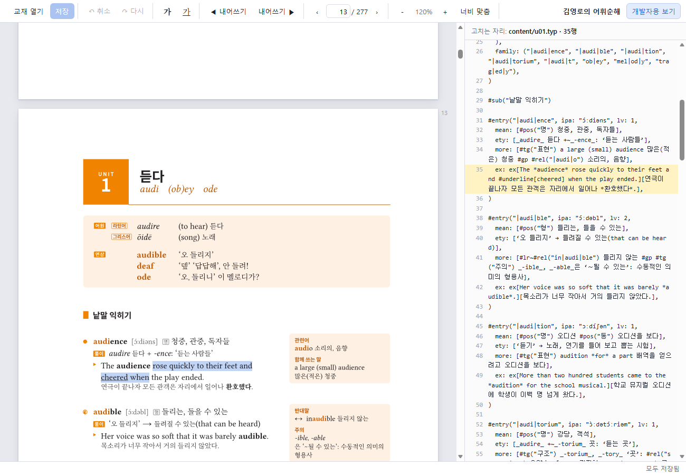

# 쉬운 지면 편집기 (Easy Typst Editor)

[English](README.md) · **한국어**



**내려받기:** [Releases](https://github.com/qnai-ai/Easy_Typst_Editor/releases/latest)에서 zip을 받아 풀고 `EasyTypstEditor.exe`를 실행한다(Windows 10/11).

**Typst 결과물을 Adobe Acrobat에서 PDF 고치듯 편집한다.** 다른 점은, 고친 내용이 PDF가 아니라 원고(.typ)에 깔끔하게 반영된다는 것.

Typst를 몰라도 쓰는 교재 지면 편집기. `main.typ` 하나를 열면 책이 쪽 단위로 펼쳐지고,
지면에서 글자를 눌러 바로 고친 뒤 저장하면 해당 원고(.typ) 파일에 반영된다.

> **오류·건의는 [GitHub Issues](https://github.com/qnai-ai/Easy_Typst_Editor/issues/new/choose)로 보내 주세요. 24시간 안에 고치겠습니다.**

- 실행 파일: `dist\EasyTypstEditor.exe` (같은 폴더의 `WebView2Loader.dll`과 함께 둔다)
- 교재를 바로 열기: `EasyTypstEditor.exe "C:\...\main.typ"`
- 빌드: `powershell -ExecutionPolicy Bypass -File build.ps1`

## 확정한 설계 (처음 계획에서 고친 점)

| 항목 | 확정 내용 |
|---|---|
| 조판 엔진 | Typst **0.15.1**을 앱에 내장(PC의 `typst` 명령과 같은 판). 같은 글꼴을 쓰므로 판형·쪽 나눔이 외부 빌드 PDF와 같다. |
| 프로젝트 인식 | `main.typ`가 있는 폴더를 뿌리로 삼고, 조판 중에 실제로 읽힌 파일만 추적한다. 폴더 밖 파일을 불러오면 위 폴더로 한 단계씩 넓혀 다시 시도한다. |
| 지면 ↔ 원고 대응 | ① Typst가 알려 주는 글자별 원본 위치를 쓰되, 원고 글과 **대조해 검증**한다. ② 템플릿의 `show regex(..)`(한글 0.84배 등) 때문에 위치가 사라진 글자는 **지면의 글과 원고의 글을 대조**해 되찾는다(앞뒤 문맥이 맞거나 개수가 꼭 같을 때만). ③ 그래도 못 찾는 글은 잠근다. |
| 고칠 수 있는 글 | 본문 마크업 글자(예문·번역문·설명문 등)는 전부. `title: "듣다"`, `#sub("낱말 익히기")` 같은 **따옴표 문자열**은 글자만(굵게·밑줄·줄 나눔 불가). |
| 잠기는 글 | 쪽 번호·차례·쪽 아래 반복 제목·`|audi|ence`처럼 가공되는 표제어·템플릿이 만드는 갈래 이름. 누르면 이유를 보여 준다. |
| 굵게 | `*글*`. 영문 낱말 한가운데처럼 `*`가 깨지는 자리는 `#strong[글]`로 쓴다. |
| 밑줄 | 템플릿에 `#let u(` 가 있으면 `#u[글]`, 없으면 `#underline[글]`. |
| Enter / Shift+Enter | 빈 줄(문단 나눔) / `\ `(강제 줄바꿈). 굵게·밑줄 안에서 Enter를 치면 꾸밈을 닫았다 다시 연다. |
| Tab | Typst에는 탭 위치가 없어, 줄 왼쪽 끝에서 2em 간격의 다음 자리까지 `#h(..pt)`를 넣는다(넣을 때 한 번 계산하는 고정 너비). |
| 내어쓰기 | 문단을 `#par(hanging-indent: 1em)[..]`로 감싼다. 1em씩 늘리고 줄이며 0이 되면 벗긴다. |
| 안전장치 | 고칠 때마다 구문 구조가 뜻밖에 달라지면 거부하고, 조판 오류가 나면 자동으로 되돌린다. 저장 전까지 디스크에 쓰지 않는다. 저장 직전 원본을 `%LOCALAPPDATA%\EasyTypstEditor\backup\`에 복사하고, 연 뒤에 다른 프로그램이 파일을 바꿨으면 저장하지 않는다. |
| 소스 창 | 기본 화면에서 뺐다. `개발자용 보기`를 누르면 고치는 자리의 원고가 읽기 전용으로 보인다. |

## 쓰는 법

| 동작 | 결과 |
|---|---|
| 글자 사이 누르기 / 끌기 / Shift+방향키 | 커서 / 선택 |
| 두 번 누르기 | 낱말 선택 |
| 입력·Backspace·Delete·붙여넣기(Ctrl+V) | 글자 고치기. 붙여넣기는 일반 글자와 줄바꿈(한 줄 바꿈 = 강제 줄바꿈, 빈 줄 = 새 문단) |
| Ctrl+B / Ctrl+U | 굵게 / 밑줄 켜고 끄기 |
| Enter / Shift+Enter / Tab | 새 문단 / 줄바꿈 / 탭 간격 |
| 내어쓰기 ◀ ▶ | 둘째 줄부터 들여 쓰기 |
| Ctrl+Z / Ctrl+Y / Ctrl+S / Ctrl+O | 실행 취소 / 다시 실행 / 저장 / 교재 열기 |
| Ctrl+휠, －/＋, 너비 맞춤 | 확대·축소 |

## 구조

```
src/world.rs    조판 세계: 파일을 메모리에 올리고 저장할 때만 디스크에 쓴다
src/index.rs    지면 색인: 글자마다 지면 위치와 원본 위치(바뀐 쪽만 다시 계산)
src/recover.rs  원본 위치 검증·복원(본문 대조)
src/edit.rs     원고 고치기 연산(입력·지우기·굵게·밑줄·문단·내어쓰기) + 단위 시험
src/session.rs  편집 세션: 커서·선택·이동·실행 취소·저장
src/main.rs     창(WebView2)과 화면용 내부 서버(127.0.0.1)
ui/index.html   화면
```

개발용: `EasyTypstEditor.exe --serve 47615 "main.typ"` 로 띄우면 창 없이 `http://127.0.0.1:47615/` 에서 같은 화면을 본다.
단위 시험: `cargo test --release`.

빌드 환경: Rust(MSVC, 또는 GNU 툴체인 + MinGW/WinLibs). 빌드 산출물 위치를 바꾸려면 `CARGO_TARGET_DIR`이나 `.cargo/config.toml`의 `target-dir`을 쓴다.

## 화면 언어

한국어·English·日本語·简体中文·Español을 지원한다. 처음엔 Windows 표시 언어를 따르고, 도구 모음 오른쪽 끝의 🌐 메뉴에서 바꾸면 기억한다
(`%LOCALAPPDATA%\EasyTypstEditor\settings.json`). 환경 변수 `EASY_TYPST_LANG=ko|en|zh|ja|es`가 있으면 그것이 우선한다.
번역문은 `ui/i18n.json` 한 파일에 있다(엔진 안내문과 화면 글 모두).

## 알려진 한계

- 빈 문단에는 커서를 그릴 글자가 없어, Enter 직후 커서가 앞 문단 끝에 보인다(입력하면 새 문단에 들어간다).
- `#pos("명")`, `#gp` 같은 템플릿 요소는 지면에서 지울 수 없다(선택 삭제에 통째로 들어간 경우는 지워진다).
- 같은 글이 한 쪽에 여러 번 나오고 문맥으로도 가릴 수 없으면 잠근다(잘못 잇는 것보다 안전하게).
- 글자 크기·색·정렬·표·그림 편집, 찾기·바꾸기는 아직 없다.

## .typ 더블클릭으로 열기

`register.ps1`을 실행하면 .typ 파일이 이 편집기로 열린다(현재 사용자만). 처음 한 번은 Windows의 '앱 선택' 창에서 EasyTypstEditor를 고르고 '항상'을 눌러야 한다. 되돌리기: `register.ps1 -Undo`.
장별 원고(content/u01.typ 등)를 열어도 같은 폴더나 위 폴더의 main.typ를 찾아 교재 전체를 연다.


## 요소를 통째로 지우기·옮기기

글자가 아니라 덩어리(표제지의 통계 줄, 자리 잡힌 제목, `#pos("명")` 같은 템플릿 요소)는 **Alt를 누른 채 누르거나** 도구 모음의 「요소 고르기」로 고른다.

- 지우기: Delete. 옮기기: 끌거나 방향키(1pt, Shift는 5pt). 「넓히기」로 그 요소를 품은 더 큰 요소를 고른다.
- 옮기기는 원고에서 `place`·`move`의 `dx`/`dy` 값을 고치고, 그런 값이 없으면
  `{ let it = 요소; place(dx: .., dy: .., it); hide(it) }` 로 바꾼다(제자리에 보이지 않는 사본을 두어 다른 글이 밀리지 않게 함).
  글줄 안에 낀 요소는 `box(move(..))`로 감싼다.
- 템플릿 함수 안의 요소는 그 함수가 쓰인 모든 곳이 함께 바뀐다(고를 때 몇 곳인지 알려 준다).
