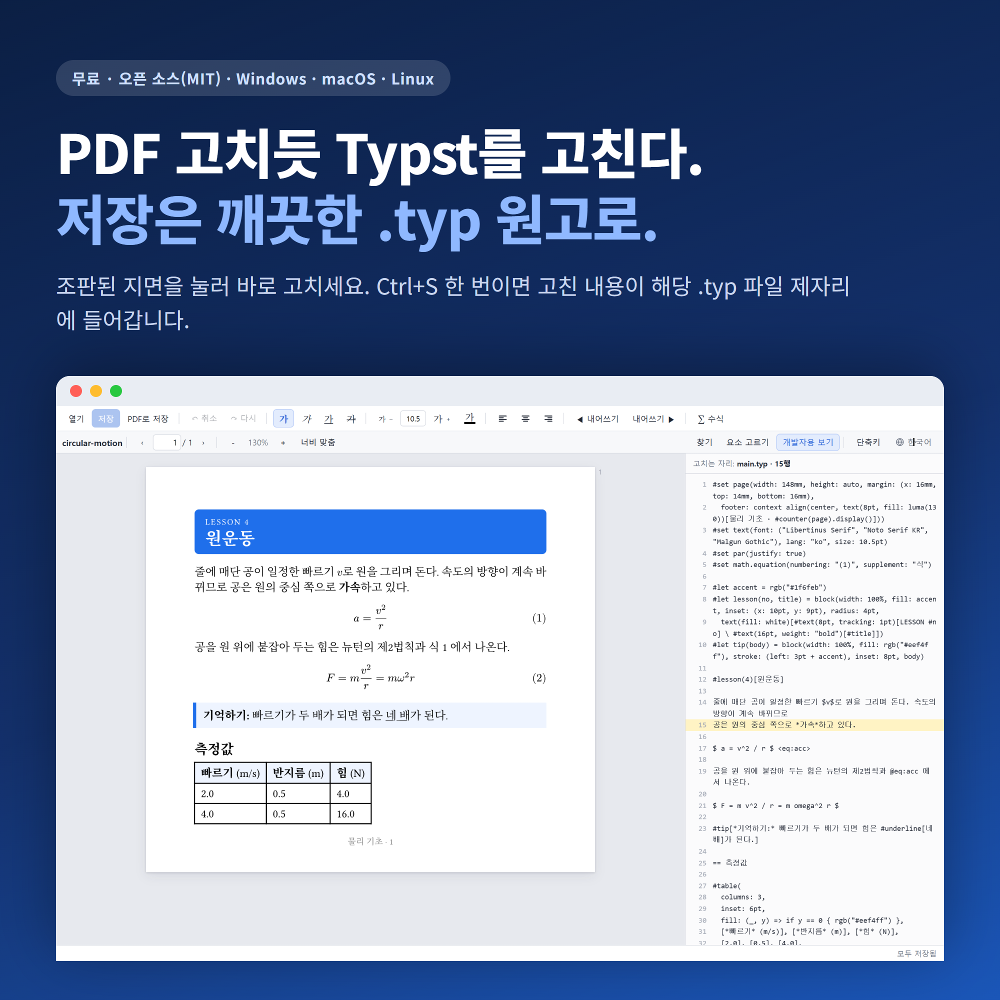
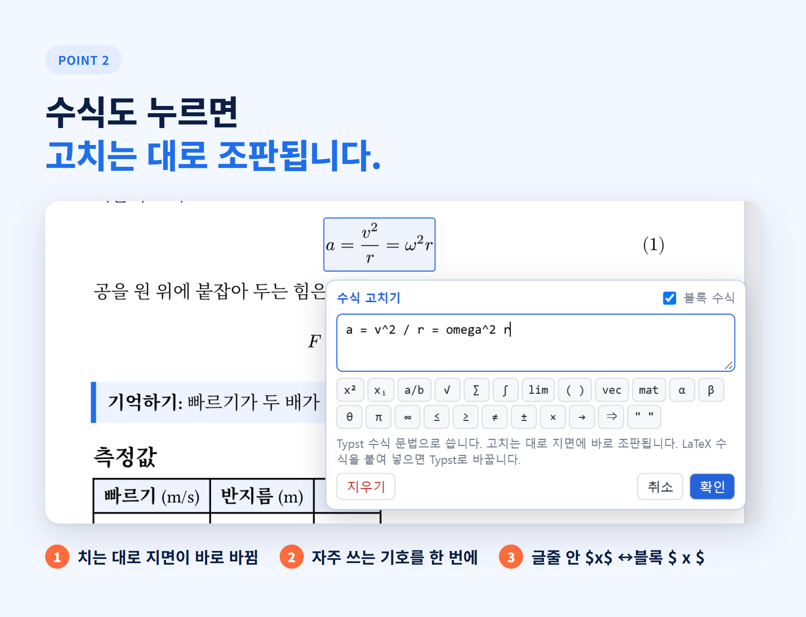
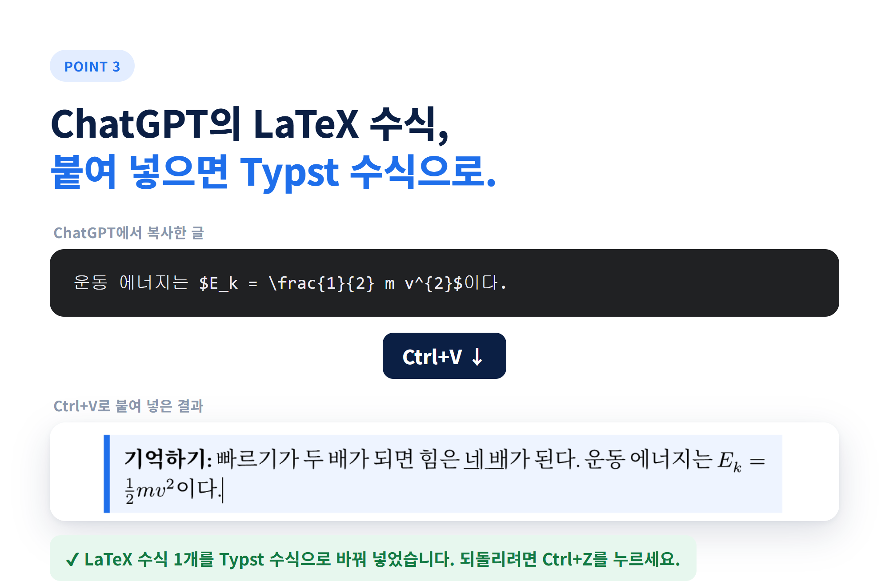

 

&nbsp;

&nbsp;

[English](README.md) · **한국어**

 

## 😩 이런 적, 있으시죠?

> 💬 *“132쪽 셋째 줄에 오타 하나만 고쳐 주세요.”* — 공동 저자에게 또 메시지가 왔다.
>
> 💬 *“.typ 파일은 열어 봤는데… 어디를 고쳐야 할지 모르겠어요.”* — 편집자는 마크업 앞에서 멈췄다.
>
> 💬 *“ChatGPT가 준 수식이 전부 LaTeX예요.”* — 하나하나 Typst로 다시 쳤다.

[Typst](https://typst.app)는 훌륭한 조판 시스템이지만, **고치는 사람이 모두 Typst를 알지는 않습니다.**
**쉬운 지면 편집기**는 조판된 *지면* 위에서 바로 고치게 해 주고, 결과는 그대로 깨끗한 `.typ` 원고로 남깁니다.

 

 

## ✨ 핵심 기능 5가지

- 지면의 글자를 누르고 그대로 치세요. 고르기, 지우기, 붙여넣기, 찾기·바꾸기까지 워드와 같습니다.
- **Ctrl+B → `*굵게*`, Ctrl+I → `_기울임_`, Ctrl+U → `#underline[..]`.** 사람이 쓴 것 같은 Typst가 남습니다.
- 여러 파일로 나뉜 책도 OK. 고친 글은 그 글이 나온 파일(`content/ch01.typ` …)의 그 줄로 들어갑니다.

 

- 수식을 누르면 원문 창이 뜨고, **치는 대로 지면이 바로 다시 조판**됩니다. 문법이 틀려도 지면은 깨지지 않아요.
- Enter는 확인, Esc는 취소, 한 수식을 고친 것은 되돌리기 한 번. 새 수식은 **Ctrl+M**.
- 수식 번호와 꼬리표(`<eq:1>`)는 그대로. 본문의 “식 1” 참조도 알아서 따라갑니다.

 

- `$..$`, `$$..$$`, `\(..\)`, `\[..\]` 모두 알아봅니다. 수식 창에 붙여 넣어도 바꿔 줍니다.
- 그냥 글로 넣고 싶으면 **Ctrl+Shift+V**. `$5 and $6` 같은 금액은 수식으로 오해하지 않습니다.
- 변환은 오픈 소스 [tex2typst](https://github.com/qwinsi/tex2typst)(Apache-2.0)가 맡습니다. 인터넷 연결 없이 PC 안에서 처리합니다.

 

- 칸을 누르고 바로 입력. 오른쪽 클릭으로 **줄·칸 넣기와 지우기**.
- 표나 상자 안을 누르면 가장자리에 손잡이가 생깁니다. 끌면 **칸 너비·줄 높이·상자 크기**가 바뀌고, 원고에 적힌 단위(`mm`, `%`, `fr`)를 지킵니다.
- 그림은 눌러서 크기 조절, 「그림 바꾸기」로 파일 교체.

 

- 고칠 때마다 구문을 검사해, 조판이 깨질 고침은 **자동으로 되돌립니다.**
- 쪽 번호·차례·참조처럼 템플릿이 만드는 글은 잠기고, 누르면 이유를 알려 줍니다.
- 저장 전까지 디스크는 그대로. 저장할 때마다 원본을 따로 백업하고, 다른 프로그램이 그새 파일을 바꿨으면 덮어쓰지 않습니다.

 

## 📚 이렇게 씁니다 — 상세 사례

> 아래 1~3은 이 편집기가 잘 맞는 **대표적인 상황을 예로 든 것**이고, 4는 실제로 만들고 있는 책입니다.

<table>
<tr><td width="50%" valign="top">

### 📖 사례 1. 교재 공동 저자의 오탈자 수정

**상황** 출판사 편집자가 300쪽 교재 PDF를 검토하다 오탈자 40곳을 찾았습니다.
예전엔 PDF에 메모를 달아 저자에게 보내고, 저자가 `.typ`에서 하나하나 찾아 고친 뒤 다시 PDF를 만들어 보냈습니다.

**이렇게** 편집자가 `main.typ`를 열고, 지면에서 바로 고치고, Ctrl+S.
Ctrl+F로 같은 실수를 찾아 「모두 바꾸기」.

**결과** 저자와 주고받는 왕복이 **0번**. 저자는 git에서 바뀐 줄만 확인하면 끝.

</td><td width="50%" valign="top">

### 🧮 사례 2. 수학 선생님의 학습지

**상황** ChatGPT로 문제를 만들면 수식이 전부 `\frac{a}{b}` 같은 LaTeX로 나옵니다.

**이렇게** 답을 통째로 복사해 지면에 붙여 넣으면 글은 글대로, 수식은 Typst 수식으로 들어갑니다.
마음에 안 드는 수식은 눌러서 고치면 바로 조판된 모습이 보입니다.

**결과** 수식을 다시 칠 필요가 없습니다. 학습지 한 장이 붙여넣기 몇 번으로 끝.

</td></tr>
<tr><td width="50%" valign="top">

### 🔬 사례 3. 대학원생의 실험 보고서

**상황** 측정을 한 번 더 해서 표에 줄을 늘리고, 식 하나의 계수를 바꿔야 합니다. 마감은 한 시간 뒤.

**이렇게** 표 안에서 오른쪽 클릭 → 「아래에 줄 넣기」, 칸을 눌러 값 입력.
좁은 칸은 손잡이를 끌어 넓히고, 식은 눌러서 계수만 고칩니다.

**결과** 식 번호와 “식 2” 참조는 Typst가 그대로 맞춰 줍니다. 원고는 여전히 깔끔한 Typst.

</td><td width="50%" valign="top">

### 🏷️ 사례 4. 실제로 만들고 있는 277쪽 어휘 교재

이 편집기는 **실제 책을 만들려고** 태어났습니다.
277쪽짜리 어휘 교재를 이 편집기로 고치고 있고, 한 번 고칠 때마다 **0.5초 안팎**이면 다시 조판됩니다.

복잡한 템플릿(표제어 가공, 장별 파일, 자동 차례)이 있어도
고칠 수 있는 글은 고치고, 템플릿이 만든 글은 안전하게 잠급니다.

</td></tr>
</table>

 사례 4 · 실제 교재 화면. 오른쪽은 「개발자용 보기」로 연 원고(고치는 줄이 노랗게 표시됩니다).

 

## 🆚 원고를 직접 고칠 때와 비교하면

| | `.typ` 원고를 직접 고칠 때 | **쉬운 지면 편집기** |
|---|---|---|
| 고칠 곳 찾기 | PDF에서 보고, 원고에서 다시 검색 | **지면에서 바로 누르기** |
| 문법 실수 | 괄호 하나로 조판이 깨질 수 있음 | **깨질 고침은 자동으로 되돌림** |
| 수식 | 문법을 외워서 입력 | **누르고 고치면 바로 조판 · LaTeX 붙여넣기** |
| 표 줄·칸 추가 | 칸 수를 세어 `[..]` 입력 | **오른쪽 클릭 한 번** |
| 함께 일하는 사람 | Typst를 배워야 함 | **워드를 쓸 줄 알면 충분** |
| 결과물 | `.typ` | **똑같이 깨끗한 `.typ`** (git으로 비교 가능) |

 

## ⬇️ 내려받기 · 실행

**[Releases](https://github.com/qnai-ai/Easy_Typst_Editor/releases/latest)** 에서 내 시스템용 꾸러미를 받아 풀고 실행한 뒤 `main.typ`를 고르세요.
처음이라면 [`examples/hello/main.typ`](examples/hello/main.typ)로 시작해 보세요.

| 시스템 | 꾸러미 | 실행 |
|---|---|---|
| 🪟 **Windows 10/11** | `…-windows-x64.zip` | `EasyTypstEditor.exe` |
| 🍎 **macOS 11 이상** (Apple Silicon · Intel) | `…-macos-universal.zip` | `Easy Typst Editor.app` |
| 🐧 **Linux** (x86-64) | `…-linux-x64.tar.gz` | `./EasyTypstEditor` (WebKitGTK 4.1 필요) |

<b>macOS · Linux에서 처음 실행할 때</b>

- **macOS:** Apple의 공증을 받지 않은 앱이라 처음 실행이 막힙니다. *시스템 설정 → 개인정보 보호 및 보안 → 그래도 열기*로 한 번 허용하거나
  `xattr -dr com.apple.quarantine "Easy Typst Editor.app"`을 실행하세요.
- **Linux:** 웹뷰가 없으면 설치하세요 — Debian/Ubuntu `sudo apt install libwebkit2gtk-4.1-0`, Fedora `sudo dnf install webkit2gtk4.1`,
  Arch `sudo pacman -S webkit2gtk-4.1`. `sh register.sh`로 앱 메뉴에 넣고 .typ 더블클릭으로 열 수 있습니다.
- **Windows:** `register.ps1`을 실행하면 .typ 파일을 더블클릭으로 엽니다.

 

## ❓ 자주 묻는 질문

<b>정말 무료인가요?</b>

네. MIT 라이선스 오픈 소스입니다. 개인·회사·학교 어디서나 무료로 쓰고 고쳐서 배포해도 됩니다.

<b>Typst를 전혀 몰라도 쓸 수 있나요?</b>

네. 글을 고치고, 굵게 하고, 표에 줄을 넣는 일은 워드처럼 하면 됩니다. 수식만은 Typst 수식 문법으로 쓰지만, 기호 단추와 LaTeX 붙여넣기가 도와줍니다.

<b>제 원고가 망가지지 않을까요?</b>

고칠 때마다 구문을 검사하고, 조판이 깨지면 자동으로 되돌립니다. 저장하기 전에는 디스크에 쓰지 않고, 저장할 때마다 원본을 백업합니다.
Ctrl+Z로 몇 번이고 되돌릴 수 있습니다.

<b>문서가 인터넷으로 나가나요?</b>

아니요. Typst 조판 엔진(0.15.1)이 앱 안에 들어 있어 모든 일이 내 PC 안에서 일어납니다. 화면과 엔진은 내 PC 안(127.0.0.1)에서만 이야기합니다.

<b>`typst compile`로 만든 PDF와 똑같이 보이나요?</b>

네. 같은 Typst 0.15.1 엔진과 같은 글꼴을 쓰므로 판형·쪽 나눔이 같습니다. 「PDF로 저장」(Ctrl+P)도 같은 엔진으로 만듭니다.

<b>어떤 글은 왜 고쳐지지 않나요?</b>

쪽 번호·차례·참조 번호처럼 템플릿이 계산해서 만드는 글은 원고에 그 글자가 없어 잠깁니다. 누르면 이유가 나오고,
덩어리째 옮기거나 지우려면 Alt+클릭으로 고르면 됩니다. 잠기면 안 될 글이 잠긴다면 [이슈](https://github.com/qnai-ai/Easy_Typst_Editor/issues/new/choose)로 알려 주세요.

<b>단축키를 한눈에 보고 싶어요</b>

macOS에서는 Ctrl 대신 ⌘, Alt 대신 ⌥를 씁니다. 앱에서 F1을 누르면 전체 표가 나옵니다.

| 키 | 하는 일 |
|---|---|
| 누르기 · 끌기 · Shift+방향키 | 커서 · 선택 |
| Ctrl+B · Ctrl+I · Ctrl+U | 굵게 · 기울임 · 밑줄 |
| Ctrl+Z · Ctrl+Y · Ctrl+S · Ctrl+P | 되돌리기 · 다시 · 저장 · PDF로 저장 |
| Ctrl+F · Ctrl+H | 찾기 · 바꾸기 |
| 수식 누르기 · Ctrl+M | 수식 고치기 · 새 수식 넣기 |
| Ctrl+V · Ctrl+Shift+V | 붙여넣기(LaTeX → Typst) · 그대로 붙여넣기 |
| 표 안에서 오른쪽 클릭 | 줄·칸 넣기와 지우기 |
| Alt+클릭 | 덩어리째 고르기(옮기기·지우기) |

 

## 🐞 오류·건의는 24시간 안에 고칩니다

이상한 점이나 바라는 기능은 **[GitHub Issues](https://github.com/qnai-ai/Easy_Typst_Editor/issues/new/choose)** 로 알려 주세요. 24시간 안에 고치겠습니다.
문제가 보이는 작은 `.typ` 파일이나 화면 캡처를 함께 주시면 훨씬 빨라집니다.
도움이 되셨다면 ⭐ 하나가 다른 Typst 사용자들이 이 도구를 찾는 데 큰 힘이 됩니다.

## 📘 더 알아보기

- **[자세한 설명서](docs/manual.ko.md)** — 모든 기능, 단축키 전체, 설계 원칙, 구조, 빌드, 알려진 한계
- 번역 기여: 화면 글은 모두 [`ui/i18n.json`](ui/i18n.json) 한 파일에 있습니다(한국어 · English · 日本語 · 简体中文 · Español).

## 라이선스

[MIT](LICENSE). 오픈 소스 [Typst](https://github.com/typst/typst) 컴파일러(Apache-2.0)와 [tex2typst](https://github.com/qwinsi/tex2typst)(Apache-2.0, 라이선스: [`ui/vendor/tex2typst.LICENSE.txt`](ui/vendor/tex2typst.LICENSE.txt))를 담고 있습니다.
Typst GmbH 및 Adobe와는 관계가 없습니다.
