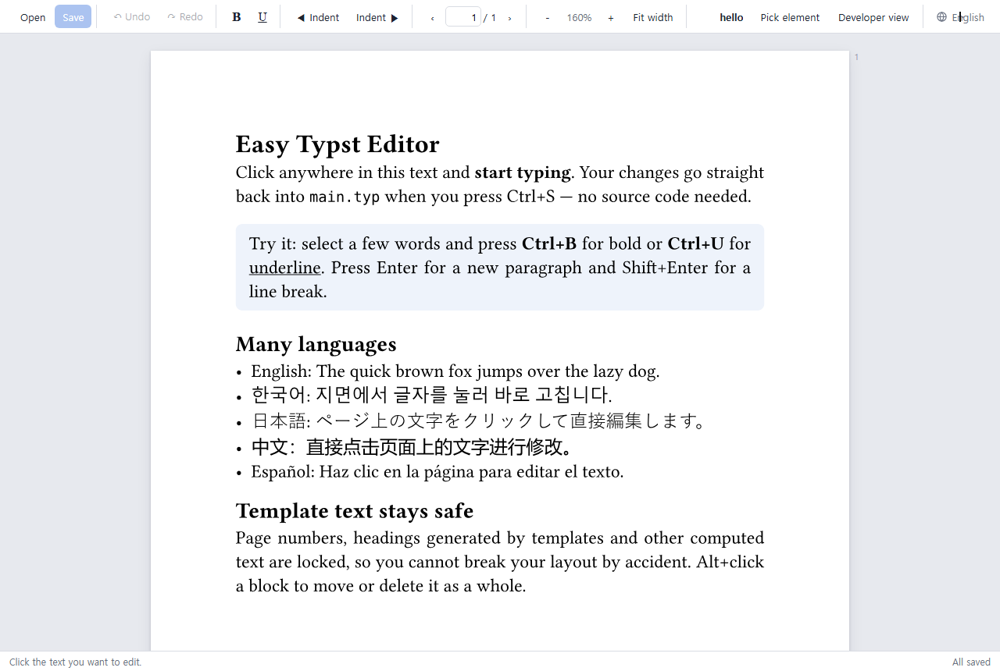

<div align="center">

# Easy Typst Editor

**Edit your Typst output the way you'd edit a PDF in Adobe Acrobat — except every change goes back into clean `.typ` source.**

Open a `main.typ`, see every page exactly as Typst typesets it, click on the text and type.
Ctrl+S writes the change back into the right spot of the right `.typ` file.

🐞 **Found a bug or have an idea? [Open a GitHub issue](https://github.com/qnai-ai/Easy_Typst_Editor/issues/new/choose) — I fix reported issues within 24 hours.**

[](https://github.com/qnai-ai/Easy_Typst_Editor/releases/latest)


[](LICENSE)

**English** · [한국어](README.ko.md)



</div>

## Why?

[Typst](https://typst.app) is a wonderful typesetting system — but the people who need to *fix a typo in the book*
(editors, co-authors, proofreaders, teachers, students) often don't want to touch markup.
Easy Typst Editor lets them work on the **rendered pages**, while the result is still an ordinary,
version-control-friendly Typst project.

It was built to edit real books: a 277-page textbook re-typesets in about half a second per edit.

## Features

- **What you see is the real output.** Typst 0.15.1 is embedded, so pages, fonts and page breaks match `typst compile`.
- **Click and type.** Insert, delete, paste, select by drag / double-click / Shift+arrows.
- **Formatting that writes clean Typst:** Ctrl+B → `*bold*`, Ctrl+U → `#underline[...]` (or your template's own `#u[...]`),
  Enter → new paragraph, Shift+Enter → `\` line break, Tab, hanging indent.
- **Multi-file projects.** Edits go to whichever included file the text came from (`content/ch01.typ`, …).
- **Template text is protected.** Page numbers, outlines, headers and other computed text are locked — click them and the editor explains why.
- **Move or delete whole blocks.** Alt+click any element (a placed label, a heading line, a template element) to drag it or delete it.
- **Safe by design.** Every edit is checked against the syntax tree and rolled back if it would break compilation; nothing touches the disk until you save;
  the original is backed up before each save; and it refuses to overwrite a file another program changed in the meantime.
- **Developer view.** Optionally shows the source line you are editing.
- **5 UI languages:** English (default), 한국어, 日本語, 简体中文, Español — switch in the 🌐 menu, top-right; your choice is remembered.

## Download & run

1. Download the zip from **[Releases](https://github.com/qnai-ai/Easy_Typst_Editor/releases/latest)** and unzip it anywhere.
2. Run `EasyTypstEditor.exe` (keep `WebView2Loader.dll` next to it) and choose your project's `main.typ`.
   Try [`examples/hello/main.typ`](examples/hello/main.typ) first.

Requires Windows 10/11 with the Microsoft Edge WebView2 Runtime (preinstalled on current Windows).
You can also open a file directly: `EasyTypstEditor.exe "C:\path\to\main.typ"`, or run `register.ps1` to open `.typ` files with a double-click.

## Keyboard

| Keys | Action |
|---|---|
| Click / drag / Shift+arrows / double-click | Caret / select / select word |
| Ctrl+B · Ctrl+U | Bold · underline |
| Enter · Shift+Enter · Tab | New paragraph · line break · tab |
| Ctrl+Z · Ctrl+Y | Undo · redo |
| Ctrl+S · Ctrl+O | Save · open |
| Alt+click | Pick a whole element (then drag, arrow keys, or Delete) |
| Ctrl+wheel | Zoom |

## How it works

Typst knows which source span produced each glyph. The editor builds an index from every glyph on the page to its
source position, **verifies** it against the source text, and recovers positions that `show` rules lose by matching the
rendered text against the source. Text that cannot be mapped safely is locked rather than guessed.
Each edit is applied to the source in memory, the document is re-typeset incrementally, and the pages are redrawn as SVG.

```
src/world.rs    Typst World: files in memory, written to disk only on save
src/index.rs    glyph ↔ source index (recomputed only for changed pages)
src/recover.rs  verifying / recovering source positions
src/edit.rs     source edits (insert, delete, bold, underline, paragraphs, indent, elements) + unit tests
src/session.rs  editing session: caret, selection, undo, save
src/lang.rs     UI language (strings in ui/i18n.json)
src/main.rs     window (WebView2) + local UI server on 127.0.0.1
ui/index.html   the UI
```

## Build from source

```powershell
# Rust (MSVC toolchain, or GNU toolchain + MinGW)
powershell -ExecutionPolicy Bypass -File build.ps1   # → dist\EasyTypstEditor.exe
cargo test --release
```

Headless mode for development: `EasyTypstEditor.exe --serve 47615 main.typ`, then open `http://127.0.0.1:47615/`.

## Known limitations

- Windows only for now (the UI is a WebView; macOS/Linux ports are welcome).
- Font size, color, alignment, tables, images and find/replace are not editable yet.
- If the same text appears several times on a page and cannot be told apart by context, it is locked (safer than editing the wrong one).

## Bugs & suggestions — fixed within 24 hours

Please report anything that goes wrong, and anything you wish it did, on **[GitHub Issues](https://github.com/qnai-ai/Easy_Typst_Editor/issues/new/choose)**.
I fix reported issues within 24 hours. A minimal `.typ` file (or a screenshot) that shows the problem makes it much faster.

## Contributing

Pull requests are welcome too — especially:

- **Translations:** all UI strings live in [`ui/i18n.json`](ui/i18n.json). Add your language code to each entry and to `LANGS` in `src/lang.rs`.
- Templates or documents where text gets locked unexpectedly (a minimal `.typ` reproduction helps a lot).
- macOS / Linux support.

If this tool saves you time, a ⭐ helps other Typst users find it.

## License

[MIT](LICENSE). Easy Typst Editor is not affiliated with Typst GmbH or Adobe; it embeds the open-source [Typst](https://github.com/typst/typst) compiler (Apache-2.0).
