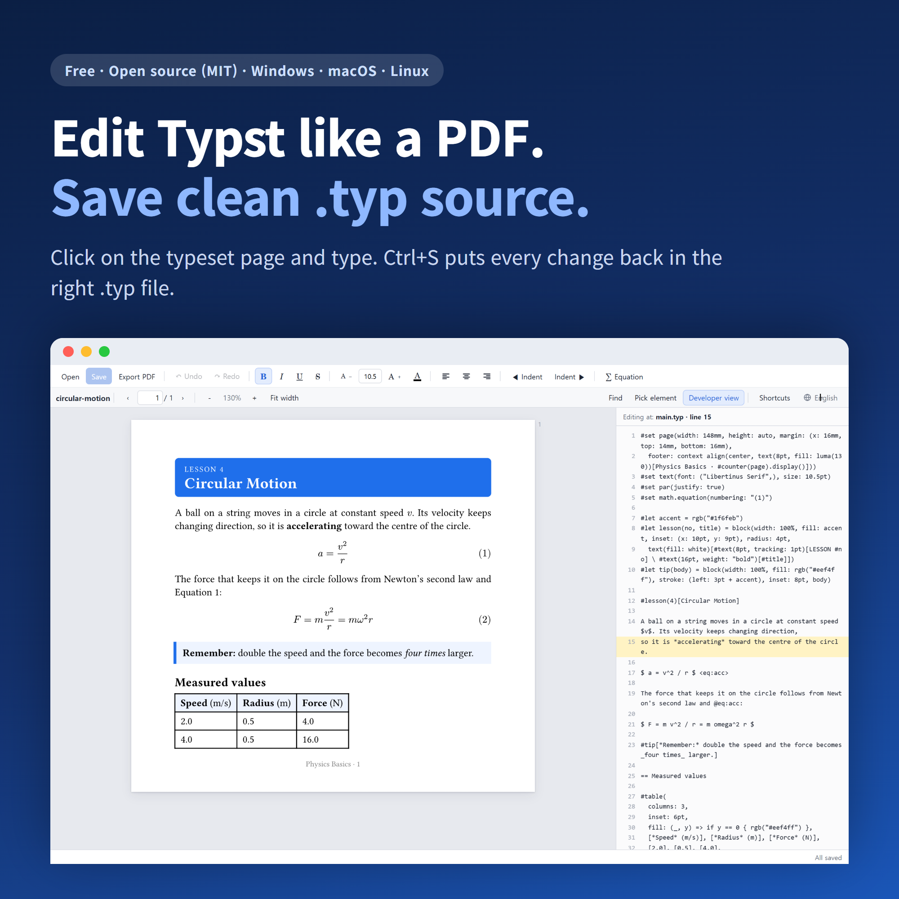
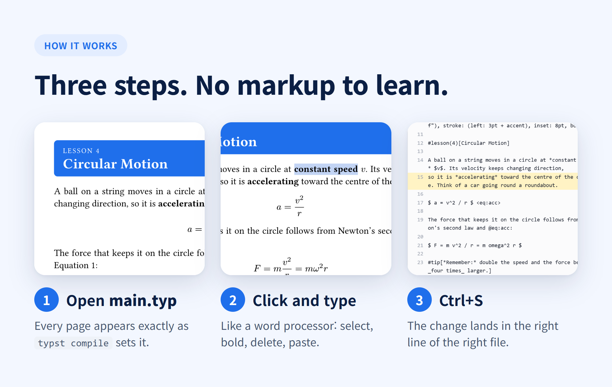
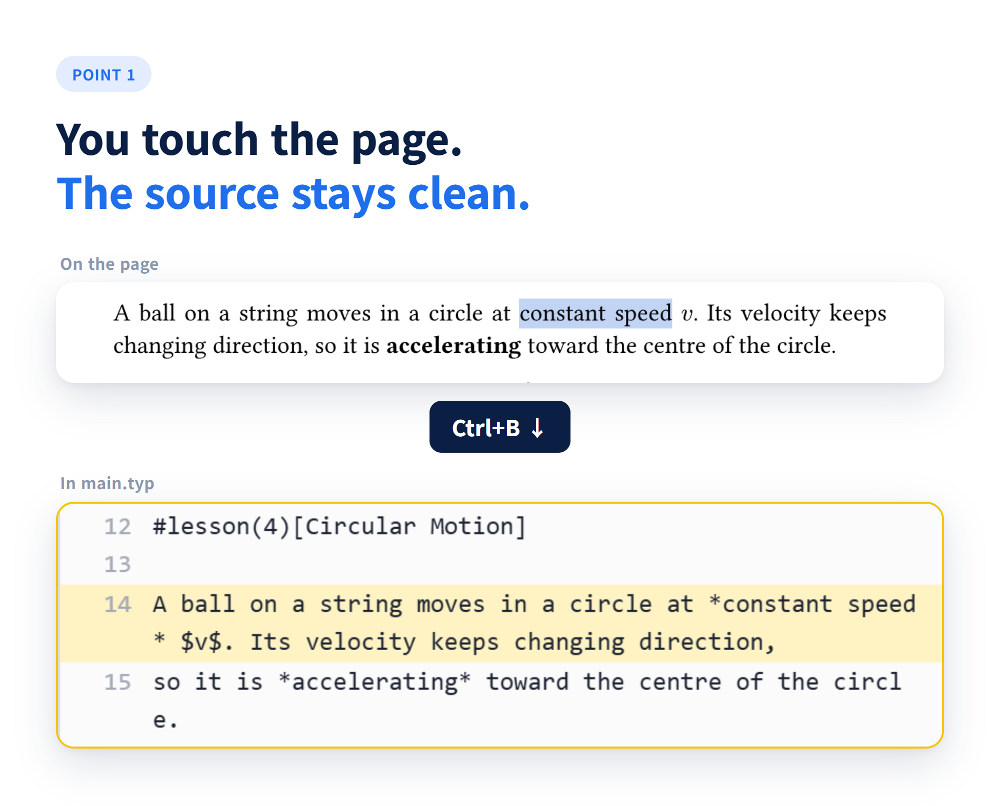
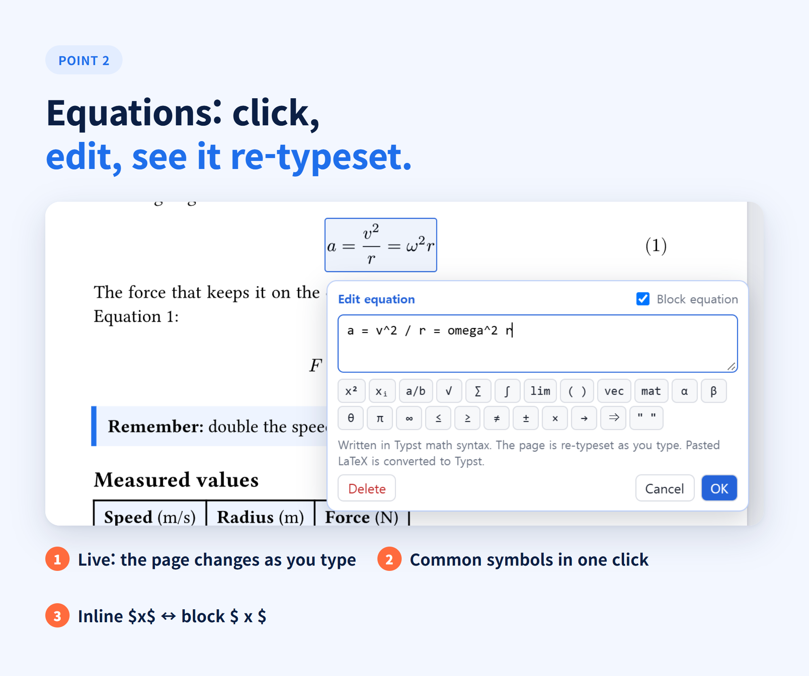
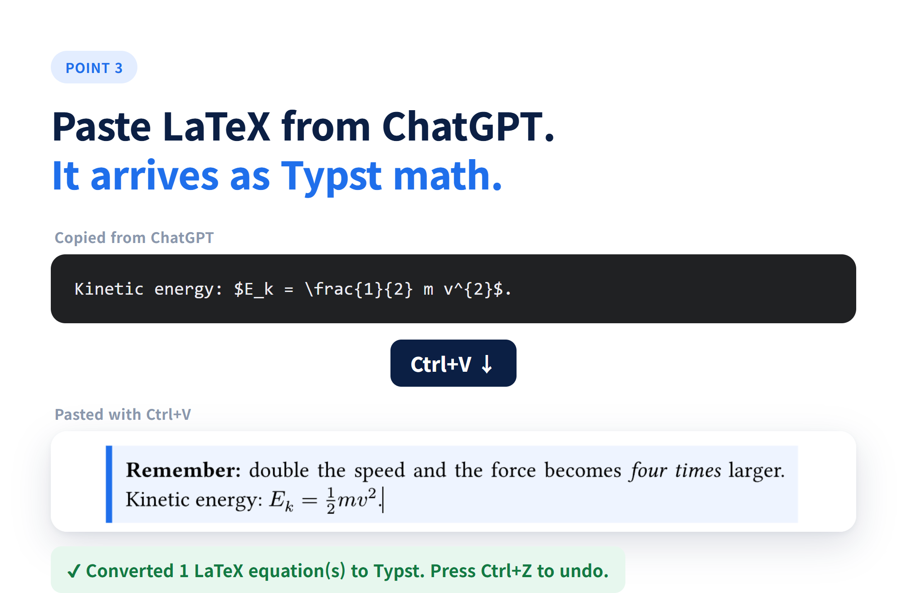
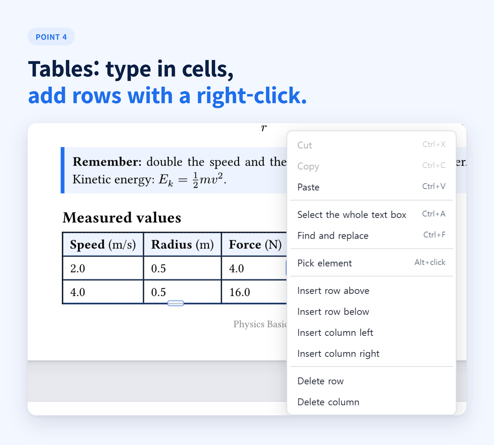
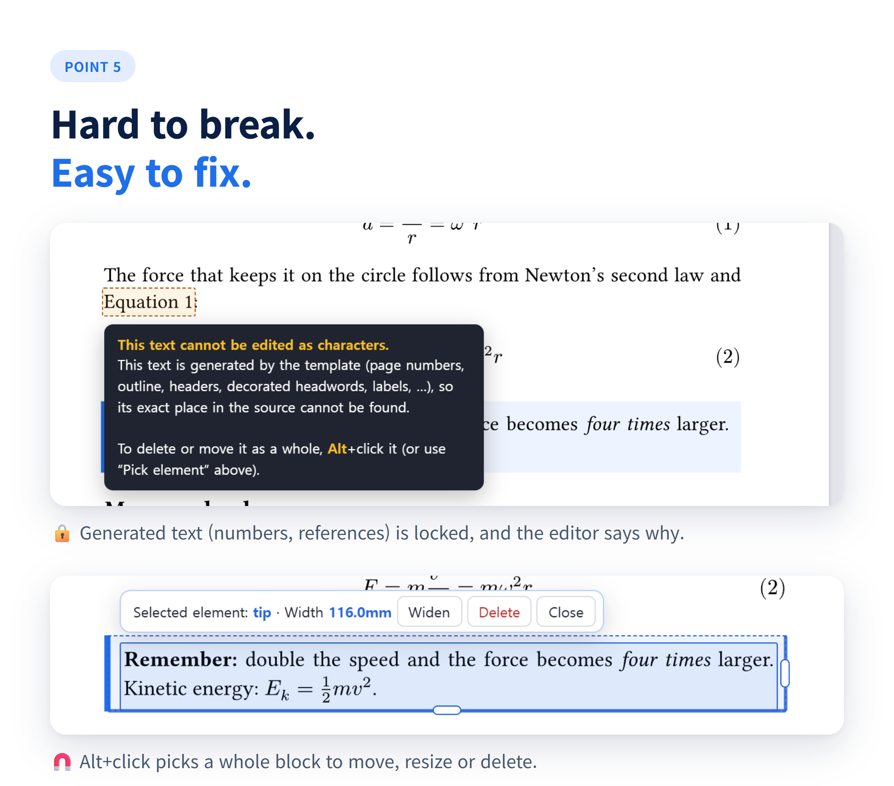
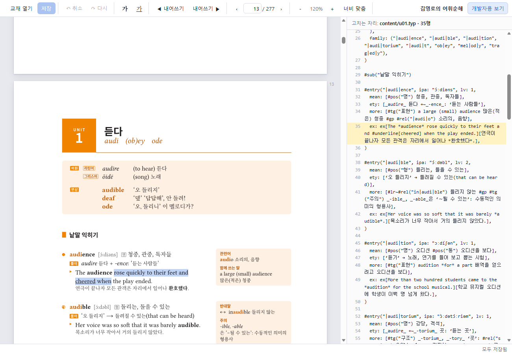

 

&nbsp;

&nbsp;

**English** · [한국어](README.ko.md)

 

## 😩 Sound familiar?

> 💬 *“Could you fix one typo on page 132, line 3?”* — your co-author, again.
>
> 💬 *“I opened the .typ file… but I have no idea where to change it.”* — your editor, stuck in front of markup.
>
> 💬 *“Every formula ChatGPT gave me is LaTeX.”* — so you retype them all in Typst.

[Typst](https://typst.app) is a wonderful typesetting system — but **not everyone who needs to fix a document knows Typst.**
**Easy Typst Editor** lets you edit right on the typeset *page*, and keeps the result as clean `.typ` source.

 

 

## ✨ Five things it does well

- Click any text on the page and type. Select, delete, paste, find & replace — just like a word processor.
- **Ctrl+B → `*bold*`, Ctrl+I → `_italic_`, Ctrl+U → `#underline[..]`.** The source reads as if a person wrote it.
- Multi-file books are fine: each edit lands in the file and line it came from (`content/ch01.typ` …).

 

- Click an equation to open its source; **the page re-typesets as you type.** A typo never breaks the page.
- Enter to confirm, Esc to cancel, one undo per equation edit. **Ctrl+M** inserts a new one.
- Equation numbers and labels (`<eq:1>`) stay put, and “Equation 1” references follow along.

 

- Understands `$..$`, `$$..$$`, `\(..\)` and `\[..\]` — also when pasted into the equation box.
- **Ctrl+Shift+V** pastes plain text. Prices like `$5 and $6` are not mistaken for math.
- Conversion is done by the open-source [tex2typst](https://github.com/qwinsi/tex2typst) (Apache-2.0), entirely on your PC.

 

- Click a cell and type. Right-click to **insert or delete rows and columns.**
- Click inside a table or box and handles appear: drag to resize **column widths, row heights and boxes**, keeping the units in your source (`mm`, `%`, `fr`).
- Click an image to resize it; “Replace image” swaps the file.

 

- Every edit is syntax-checked; an edit that would break typesetting is **rolled back automatically.**
- Text your template generates (page numbers, outline, references) is locked, and tells you why when clicked.
- Nothing touches the disk until you save. Each save backs up the original, and it won't overwrite a file another program changed meanwhile.

 

## 📚 How people use it — use cases

> Cases 1–3 are **illustrative scenarios** of where the editor fits best; case 4 is a real book being made with it.

<table>
<tr><td width="50%" valign="top">

### 📖 Case 1. A co-author's proofreading pass

**Before** An editor reviewing a 300-page textbook PDF finds 40 typos.
They used to annotate the PDF, send it to the author, who hunted each one down in `.typ` and sent a new PDF back.

**Now** The editor opens `main.typ`, fixes the text on the page, hits Ctrl+S.
Same mistake everywhere? Ctrl+F → “Replace all”.

**Result** **Zero** round trips. The author just reviews the changed lines in git.

</td><td width="50%" valign="top">

### 🧮 Case 2. A math teacher's worksheet

**Before** Problems drafted with ChatGPT come with math like `\frac{a}{b}` — all LaTeX.

**Now** Copy the whole answer and paste it on the page: prose stays prose, math becomes Typst math.
Click any formula you don't like and see it re-typeset as you fix it.

**Result** No retyping formulas. A worksheet takes a few pastes.

</td></tr>
<tr><td width="50%" valign="top">

### 🔬 Case 3. A grad student's lab report

**Before** One more measurement means one more table row, and a coefficient changes in an equation. Deadline: one hour.

**Now** Right-click in the table → “Insert row below”, click the cells, type the values.
Drag a handle to widen a cramped column; click the equation and change just the coefficient.

**Result** Equation numbers and “Equation 2” references stay correct — Typst handles them. The source is still clean Typst.

</td><td width="50%" valign="top">

### 🏷️ Case 4. A real 277-page vocabulary textbook

This editor was **born to make a real book.**
A 277-page Korean vocabulary textbook is being edited with it, and each edit re-typesets in **about half a second.**

Even with a complex template (processed headwords, per-chapter files, an automatic outline),
editable text is editable, and template-generated text is safely locked.

</td></tr>
</table>

 Case 4 · the real textbook. Right: the source in the developer view (the line being edited is highlighted).

 

## 🆚 Compared with editing the source by hand

| | Editing `.typ` by hand | **Easy Typst Editor** |
|---|---|---|
| Finding the spot | Read the PDF, then search the source | **Click it on the page** |
| Syntax slips | One bracket can break the build | **Breaking edits roll back automatically** |
| Math | Memorise the syntax | **Click, edit, see it typeset · paste LaTeX** |
| Adding a table row | Count cells, type `[..]` | **One right-click** |
| Collaborators | Must learn Typst | **If they can use a word processor, they're set** |
| Output | `.typ` | **The same clean `.typ`** (diff-friendly in git) |

 

## ⬇️ Download & run

Grab the package for your system from **[Releases](https://github.com/qnai-ai/Easy_Typst_Editor/releases/latest)**, unzip, run, and pick a `main.typ`.
First time? Try [`examples/hello/main.typ`](examples/hello/main.typ).

| System | Package | Run |
|---|---|---|
| 🪟 **Windows 10/11** | `…-windows-x64.zip` | `EasyTypstEditor.exe` |
| 🍎 **macOS 11+** (Apple Silicon · Intel) | `…-macos-universal.zip` | `Easy Typst Editor.app` |
| 🐧 **Linux** (x86-64) | `…-linux-x64.tar.gz` | `./EasyTypstEditor` (needs WebKitGTK 4.1) |

<b>First run on macOS · Linux</b>

- **macOS:** the app isn't notarized by Apple, so the first launch is blocked. Allow it once in *System Settings → Privacy & Security → Open Anyway*, or run
  `xattr -dr com.apple.quarantine "Easy Typst Editor.app"`.
- **Linux:** install the webview if missing — Debian/Ubuntu `sudo apt install libwebkit2gtk-4.1-0`, Fedora `sudo dnf install webkit2gtk4.1`,
  Arch `sudo pacman -S webkit2gtk-4.1`. `sh register.sh` adds it to the app menu and opens .typ files on double-click.
- **Windows:** run `register.ps1` to open .typ files on double-click.

 

## ❓ FAQ

<b>Is it really free?</b>

Yes. It's open source under the MIT license — use, modify and redistribute it at home, at work or at school.

<b>Can I use it without knowing Typst?</b>

Yes. Fixing text, making it bold or adding a table row works like a word processor. Only math uses Typst math syntax — and the symbol buttons and LaTeX paste help with that.

<b>Could it break my source?</b>

Every edit is syntax-checked and rolled back if typesetting breaks. Nothing is written until you save, and each save backs up the original.
Ctrl+Z undoes as far back as you like.

<b>Does my document leave my computer?</b>

No. The Typst engine (0.15.1) is built into the app, so everything happens on your PC. The window talks to the engine only on 127.0.0.1.

<b>Does it look exactly like `typst compile`?</b>

Yes. Same Typst 0.15.1 engine and the same fonts, so page size and page breaks match. “Save as PDF” (Ctrl+P) uses that engine too.

<b>Why can't I edit some text?</b>

Page numbers, the outline and reference numbers are computed by your template — those characters aren't in the source, so they're locked. Clicking them tells you why;
Alt+click picks the whole element to move or delete it. If something is locked that shouldn't be, please [open an issue](https://github.com/qnai-ai/Easy_Typst_Editor/issues/new/choose).

<b>Keyboard shortcuts at a glance</b>

On macOS use ⌘ for Ctrl and ⌥ for Alt. Press F1 in the app for the full list.

| Keys | Action |
|---|---|
| Click · drag · Shift+arrows | Caret · selection |
| Ctrl+B · Ctrl+I · Ctrl+U | Bold · italic · underline |
| Ctrl+Z · Ctrl+Y · Ctrl+S · Ctrl+P | Undo · redo · save · save as PDF |
| Ctrl+F · Ctrl+H | Find · replace |
| Click an equation · Ctrl+M | Edit equation · insert equation |
| Ctrl+V · Ctrl+Shift+V | Paste (LaTeX → Typst) · paste as plain text |
| Right-click in a table | Insert / delete rows and columns |
| Alt+click | Pick a whole element (move · delete) |

 

## 🐞 Bugs fixed within 24 hours

Found something odd, or want a feature? Tell us in **[GitHub Issues](https://github.com/qnai-ai/Easy_Typst_Editor/issues/new/choose)** — we aim to fix it within 24 hours.
A small `.typ` file or a screenshot that shows the problem makes it much faster.
If it helps you, a ⭐ helps other Typst users find it.

## 📘 Learn more

- **[Full manual](docs/manual.md)** — every feature, all shortcuts, how it works, building from source, known limitations
- Translations welcome: all UI text lives in one file, [`ui/i18n.json`](ui/i18n.json) (한국어 · English · 日本語 · 简体中文 · Español).

## License

[MIT](LICENSE). Bundles the open-source [Typst](https://github.com/typst/typst) compiler (Apache-2.0) and [tex2typst](https://github.com/qwinsi/tex2typst) (Apache-2.0, license: [`ui/vendor/tex2typst.LICENSE.txt`](ui/vendor/tex2typst.LICENSE.txt)).
Not affiliated with Typst GmbH or Adobe.
